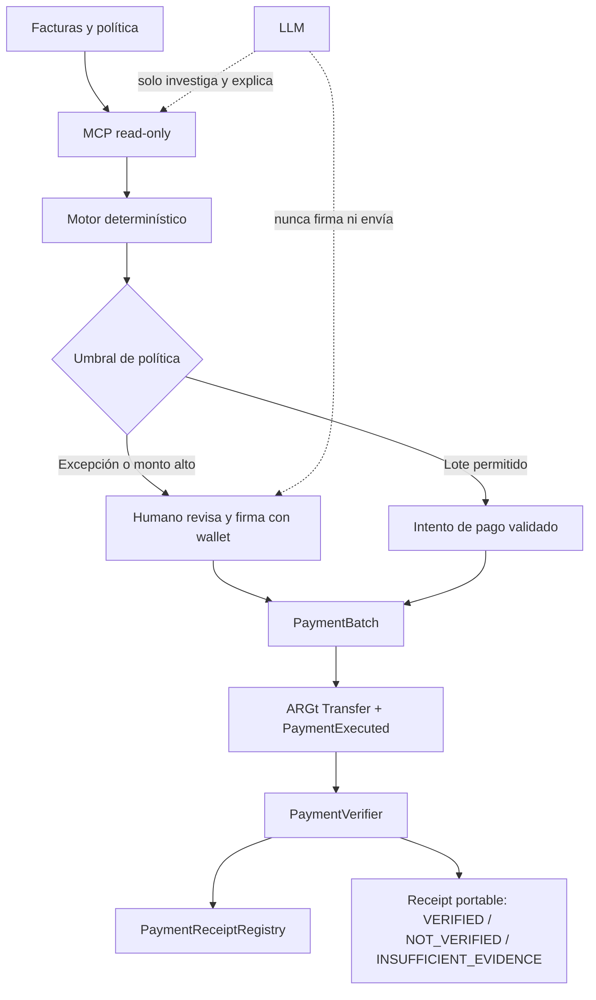

# VÉRTICE

> La IA investiga. El código decide. El humano firma. La cadena deja la prueba.

VÉRTICE es un operador de pagos a proveedores que automatiza todo el trabajo de revisión y
preparación de un lote de pagos en una stablecoin de moneda local, pero nunca le da a un
modelo de lenguaje la capacidad de mover fondos.

## El problema

Una pyme que paga a varios proveedores en moneda local enfrenta el mismo trabajo manual
cada período: facturas en formatos distintos, direcciones de proveedores que cambian o se
tipean mal, facturas duplicadas fáciles de pasar por alto, pagos sin un comprobante
portable y verificable, y la necesidad de repetir los mismos controles en cada lote. El
negocio necesita que una parte de ese trabajo se automatice sin entregarle a una IA
control irrestricto sobre el dinero.

## Qué es VÉRTICE

VÉRTICE recibe un lote de facturas de proveedores y una política del negocio (direcciones
aprobadas, token y red permitidos, tope por pago, tope por lote, umbral de ejecución
automática). A partir de ahí:

1. Lee y normaliza las facturas.
2. Detecta duplicados, errores de destinatario, montos anómalos y excepciones.
3. Produce un informe previo (preflight) determinístico.
4. Separa cada pago en dos caminos según la política: por debajo del umbral, puede
   ejecutarse de forma automática; por encima del umbral, o ante cualquier excepción, el
   sistema se detiene y exige que una persona revise y firme con su wallet.
5. Deja un registro on-chain del lote y la referencia de cada factura.
6. Verifica la transacción resultante de forma independiente y genera un comprobante
   portable.

## Principio de diseño

**La IA no tiene una herramienta para mover dinero.** El modelo puede investigar,
proponer y explicar un resultado ya sellado, pero no puede elegir un destinatario,
alterar un monto, saltear un umbral ni convertir una verificación incompleta en una
aprobación. El veredicto de cada pago lo produce código determinístico que lee la cadena,
nunca el modelo. El contrato aplica los límites de la política (lista de destinatarios
permitidos, tope por lote) de modo que, aunque el agente se equivoque, el contrato
rechaza la operación.

## Arquitectura



El MCP actual es deliberadamente read-only: prepara propuestas y lee la cadena, pero no
tiene clave privada ni herramientas para `approve`, `payBatch`, deploy o firma.

## Red y token

- Token: **ARGt** (Twin Stablecoin, peso argentino on-chain).
- Red objetivo: **Arbitrum One** (chain ID `42161`).
- Dirección del contrato ARGt en Arbitrum: `0x59863989d080b22476db95656d0c3cc18be92214`
  (fuente: [stablecoins.twin.finance](https://stablecoins.twin.finance/)).
- Dirección del contrato `PaymentBatch`:
  [`0x21Bf9822877502Ea7e5C2F973c0E335174763965`](https://arbiscan.io/address/0x21Bf9822877502Ea7e5C2F973c0E335174763965)
- Dirección del contrato `PaymentReceiptRegistry`:
  [`0xc07e0a1854676AaA05F769D6f21db89F9B9487D9`](https://arbiscan.io/address/0xc07e0a1854676AaA05F769D6f21db89F9B9487D9)

Arbitrum se eligió por ser la red donde Twin Finance tiene liquidez y resto de
infraestructura activa para ARGt (pool en Curve, vault en Morpho) al momento de este
desarrollo. Avalanche no tiene un despliegue de ARGt publicado por Twin Finance.

### Transacción real

Primer pago ejecutado por el producto, 500 ARGt a un proveedor aprobado:
[`0x704fb8b5c104bf4e6f1b8f33140ca6079c53516741e0fe99d45b745c005cabfc`](https://arbiscan.io/tx/0x704fb8b5c104bf4e6f1b8f33140ca6079c53516741e0fe99d45b745c005cabfc)

## Estructura del repositorio

```
vertice/
├── src/
│   ├── PaymentBatch.sol            # paga un lote a destinatarios aprobados, sin custodiar fondos
│   ├── PaymentVerifier.sol         # compara un claim contra evidencia de Transfer + PaymentExecuted
│   └── PaymentReceiptRegistry.sol  # publica el veredicto como un recibo portable e idempotente
├── test/           # tests unitarios, de invariantes, fuzz y adversariales (Foundry)
├── script/         # scripts de despliegue
├── web/            # VÉRTICE PROOF: portal de verificación (Vite + TS, sin wallet, sin framework)
└── lib/            # dependencias (forge-std, OpenZeppelin) como git submodules
```

`PaymentVerifier` y `PaymentReceiptRegistry` están portados de
[Veridra](https://github.com/annatchijova/veridra) (proyecto previo de la autora, mismo
patrón VERIFIED / NOT_VERIFIED / INSUFFICIENT_EVIDENCE con veredicto dominado por
cualquier chequeo en FAIL), adaptados de transferencias nativas a eventos ERC-20. El
chequeo `ORDER_BINDING_CHECK` aplica directamente una lección de un bug ya corregido en
Veridra: nunca confiar en un hecho reclamado sin re-derivarlo de forma independiente
desde la evidencia cruda — acá, el evento propio `PaymentExecuted` de `PaymentBatch` se
contrasta siempre contra el evento `Transfer` real del token, nunca se da por válido en
soledad.

## VÉRTICE PROOF

`web/` es el portal de verificación: se pega un hash de transacción (y, opcionalmente, lo
que el proveedor afirma haber cobrado) y muestra VERIFIED / NOT_VERIFIED /
INSUFFICIENT_EVIDENCE comparando el evento `PaymentExecuted` del contrato contra el
`Transfer` real de ARGt — nunca uno solo. Es de solo lectura (sin wallet, sin firma) y está
portado del frontend de [Veridra](https://github.com/annatchijova/veridra) (Vite + TypeScript
sin framework), retemado con la paleta de Twin Finance y recableado a Arbitrum en vez de
Monad.

## Desarrollo

Contratos, requiere [Foundry](https://book.getfoundry.sh/):

```shell
forge build
forge test
```

`PROOF`, requiere Node 20+:

```shell
cd web
npm install
npm run dev
```

### Herramientas MCP disponibles

El agente puede investigar, preparar y verificar pagos mediante estas herramientas. Todas
son read-only respecto de la cadena y ninguna puede firmar o enviar fondos.

| Herramienta | Función | Puede mover fondos |
|---|---|---:|
| `get_chain_status` | Consulta chain ID y último bloque de Arbitrum | No |
| `get_business_policy` | Lee límites, token y destinatarios permitidos | No |
| `get_token_config` | Expone las direcciones configuradas de ARGt y contratos | No |
| `list_invoices` | Lee un fixture JSON opcional de facturas | No |
| `create_payment_proposal` | Aplica allowlist, duplicados y límites sin enviar transacciones | No |
| `read_payment_status` | Lee un receipt real desde RPC | No |
| `verify_payment` | Contrasta `Transfer` de ARGt con `PaymentExecuted` | No |

La especificación completa, configuración y límites de autoridad están en
[`docs/MCP.md`](docs/MCP.md). El inventario de herramientas y patrones reutilizados de
VELO, MNEME, RAVEN, ZAYNOR y FORGE está en [`docs/TOOLS.md`](docs/TOOLS.md).

## Estado actual

Proyecto en etapa inicial (P0). Hechos: `PaymentBatch` (allowlist de destinatarios, tope
por lote, protección contra reuso de `runId`, sin custodia de fondos), el verificador
determinístico `PaymentVerifier` + `PaymentReceiptRegistry` (nivel de garantía
`RPC_ATTESTED`, como en Veridra) y un MCP read-only (`mcp_server.py`) para preparación y
verificación. 41/41 tests pasan, incluyendo fuzzing y un test adversarial de reentrancy.
Desplegado en Arbitrum mainnet con una transacción real ejecutada (ver arriba). VÉRTICE
PROOF (`web/`) verificado end-to-end contra esa transacción, caso VERIFIED y caso
NOT_VERIFIED. Pendiente: API de negocio completa, dashboard `/ops` y deploy a Vercel.

## Licencia

Apache License 2.0. Ver [`LICENSE`](./LICENSE).
