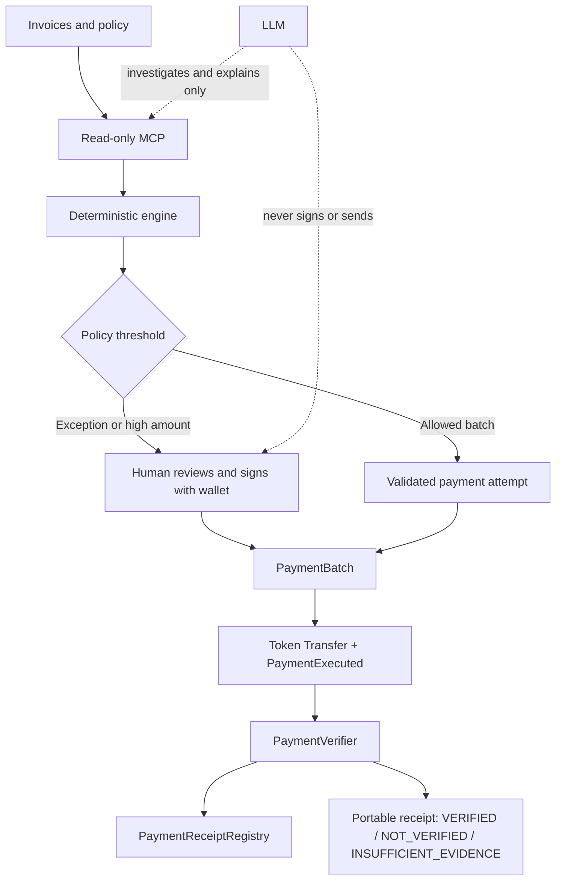

# VÉRTICE

**English · [Español](README_ES.md) · [Technical README](TECHNICAL_README.md) · [Technical README en español](TECHNICAL_README_ES.md)**


> AI investigates. Code decides. A human signs. The chain leaves the proof.

VÉRTICE is a supplier-payment operator that automates invoice review and payment-batch
preparation in local-currency stablecoins, while never giving a language model the
ability to move funds.

## The problem

An importer or exporter works with suppliers in different countries and receives
invoices in different currencies, amounts, dates, recipients, and commercial
conditions. Each period requires reviewing those obligations, detecting errors,
preparing payments, retaining receipts, and reconciling movements. Businesses lose
time checking invoices, finding duplicates, investigating discrepancies, sending
receipts, and reconstructing what happened at month-end. The work should be automated
without giving an AI unrestricted control over money.

The complete value proposition, including the business case and the distinction between
what is built today (ARGt on Arbitrum) and the multi-currency direction, is documented in
[`docs/PROPUESTA_DE_VALOR.md`](docs/PROPUESTA_DE_VALOR.md).

## What VÉRTICE is

VÉRTICE receives a supplier-invoice batch and a business policy: approved addresses,
allowed token and network, per-payment and per-batch caps, and an automatic-execution
threshold. It then:

1. Reads and normalizes invoices.
2. Detects duplicates, recipient errors, anomalous amounts, and exceptions.
3. Produces a deterministic preflight report.
4. Separates payments according to policy: below the threshold, a payment may follow
   the bounded execution path; above it, or when any exception is present, the system
   stops and requires a person to review and sign with their wallet.
5. Records the batch and each invoice reference on-chain.
6. Independently verifies the resulting transaction and produces a portable receipt.

## Design principle

**The AI has no tool for moving money.** The model may investigate, propose, and explain
an already sealed result, but it cannot choose a recipient, alter an amount, bypass a
threshold, or turn incomplete verification into approval. Deterministic code produces
each payment verdict by reading the chain, never the model. The contract enforces the
policy limits—approved recipients and batch caps—so an incorrect agent proposal is
still rejected on-chain.

## Architecture



The current MCP is deliberately read-only: it prepares proposals and reads the chain,
but has no private key and no `approve`, `payBatch`, deploy, or signing tool.

## Network and tokens

- Network: **Arbitrum One** (chain ID `42161`) for all currencies.
- Each Twin Stablecoin has its own `PaymentBatch` deployment; the token is fixed at
  deployment. `PaymentReceiptRegistry` can be shared because each claim identifies its
  `PaymentBatch`.

| Currency | ARGt/BRAt token | `PaymentBatch` | `PaymentReceiptRegistry` |
|---|---|---|---|
| **ARGt** (Argentine peso) | [`0x5986…e214`](https://arbiscan.io/address/0x59863989d080b22476db95656d0c3cc18be92214) | [`0x21Bf…3965`](https://arbiscan.io/address/0x21Bf9822877502Ea7e5C2F973c0E335174763965) | [`0xc07e…87D9`](https://arbiscan.io/address/0xc07e0a1854676AaA05F769D6f21db89F9B9487D9) |
| **BRAt** (Brazilian real) | [`0xc4ed…4df8`](https://arbiscan.io/address/0xc4ed6aba5373d78e160f4df39e011f078be54df8) | [`0xb665…47cA`](https://arbiscan.io/address/0xb6653422431C5419Df650d38D3B90C29f3a947cA) | [`0xE727…45C7`](https://arbiscan.io/address/0xE7271FbcC7f22a21485331D4581f6A8C7f6745C7) |

Token source addresses are published by [Twin Stablecoins](https://stablecoins.twin.finance/).
Arbitrum is the network where Twin Finance has the relevant liquidity and infrastructure
for these currencies at the time of this development.

### Real transaction

- ARGt — 500 ARGt to an approved supplier:
  [`0x704fb8b5…cabfc`](https://arbiscan.io/tx/0x704fb8b5c104bf4e6f1b8f33140ca6079c53516741e0fe99d45b745c005cabfc)

  Values to paste into [VÉRTICE PROOF](https://vertice-proof.vercel.app) to reproduce
  the `VERIFIED` verdict with all nine checks passing:

  ```text
  Transaction hash:     0x704fb8b5c104bf4e6f1b8f33140ca6079c53516741e0fe99d45b745c005cabfc
  Recipient:             0x981dce900787aed11e8e4489860907d2892f70ed
  Amount in base units:  500000000000000000000
  Token address:         0x59863989d080b22476db95656d0c3cc18be92214
  Payer:                 0xa6b2df351332db16c43630e8290fd893e9c71513
  Run ID:                0xcb7429a0bd1c93f0077be87ec03347c0dc647ed59a372b2f731f4fadf53c5cd6
  Invoice reference:     0x99c5fad1f0657ed78631a52dbb63d20e4344e99aa4a17545075add66b6ed52b4
  ```
- BRAt: the contract is deployed, but the payment transaction is pending real funds.
  See the exact deployment distinction in the [Technical README](TECHNICAL_README.md).

## Repository structure

```
vertice/
├── src/
│   ├── PaymentBatch.sol            # pays approved recipients without holding funds
│   ├── PaymentVerifier.sol         # compares a claim with Transfer + PaymentExecuted evidence
│   └── PaymentReceiptRegistry.sol  # publishes a portable, idempotent receipt
├── test/           # unit, invariant, fuzz, and adversarial Foundry tests
├── script/         # deployment scripts
├── web/            # VÉRTICE PROOF: wallet-free verification portal
├── ops/            # VÉRTICE OPS: merchant panel; real wallet payment path
├── mcp_server.py   # read-only MCP: policy, preflight, and verification
└── lib/            # forge-std and OpenZeppelin git submodules
```

`PaymentVerifier` and `PaymentReceiptRegistry` were ported from
[Veridra](https://github.com/annatchijova/veridra), adapting its
`VERIFIED` / `NOT_VERIFIED` / `INSUFFICIENT_EVIDENCE` semantics from native transfers
to ERC-20 events. `ORDER_BINDING_CHECK` independently compares the contract's
`PaymentExecuted` event with the token's actual `Transfer` event.

## Live applications

| App | URL | Data | What it shows |
|---|---|---|---|
| **VÉRTICE PROOF** | https://vertice-proof.vercel.app | Real | Independent Vite verifier reading Arbitrum live. |
| **VÉRTICE OPS** | https://vertice-ops.vercel.app | Mock invoice fixtures | Merchant panel; the PAY button signs a real transaction with your wallet. |
| **PROOF inside OPS** | https://vertice-ops.vercel.app/proof/`<hash>` | Real | Second verifier inside Next.js OPS, with receipt-registry checks and batch disambiguation. |

There are two independent implementations of the verifier. If they ever return
different verdicts for the same transaction, that is an alarm to investigate. If you
need one link showing independently verifiable behavior without mock invoice data, use
PROOF.

## VÉRTICE PROOF

**Live: https://vertice-proof.vercel.app**

`web/` accepts a transaction hash and optionally the supplier's claim. It compares the
contract's `PaymentExecuted` event with the actual ARGt `Transfer` and shows
`VERIFIED`, `NOT_VERIFIED`, or `INSUFFICIENT_EVIDENCE`. It is read-only, with no wallet
or signing capability.

## Development

Contracts require [Foundry](https://book.getfoundry.sh/):

```shell
forge build
forge test
```

PROOF requires Node 20+:

```shell
cd web
npm install
npm run dev
```

## Known limitations

- The independent PROOF application accepts a transaction with exactly one ARGt
  `Transfer` and one `PaymentExecuted`. Multi-payment batches can be disambiguated in
  PROOF inside OPS by providing `invoiceRef`.
- Both implementations provide `RPC_ATTESTED` assurance: they compare RPC responses
  and receipt logs, but do not independently verify a cryptographic inclusion proof in
  Arbitrum state. `RECENT_BLOCKHASH_PROOF` and `PERSISTENT_ROOT_PROOF` are not implemented.
- `PaymentBatch` is not upgradeable. New invoice-uniqueness and non-zero-reference
  checks apply only to new deployments; existing deployed addresses retain their bytecode.

### Available MCP tools

All tools are read-only with respect to the chain. None can sign or send funds.

| Tool | Function | Can move funds |
|---|---|---:|
| `get_chain_status` | Reads chain ID and latest Arbitrum block | No |
| `get_business_policy` | Reads limits, token, and approved recipients | No |
| `get_token_config` | Exposes configured ARGt and contract addresses | No |
| `list_invoices` | Reads an optional invoice JSON fixture | No |
| `create_payment_proposal` | Applies allowlists, duplicate checks, and limits without sending transactions | No |
| `read_payment_status` | Reads a real receipt from RPC | No |
| `verify_payment` | Compares ARGt `Transfer` with `PaymentExecuted` | No |

See [`docs/MCP.md`](docs/MCP.md) for the full specification, configuration, and
authority limits. [`docs/TOOLS.md`](docs/TOOLS.md) records the tool inventory and
patterns reused from VELO, MNEME, RAVEN, ZAYNOR, and FORGE.

## Authors

VÉRTICE was created by Anna Tchijova and developed with substantial frontend
contributions from [Martin Bogado](https://github.com/martinbogado).

See [AUTHORS.md](AUTHORS.md) for detailed credits.

## License

Apache License 2.0. See [`LICENSE`](LICENSE).
