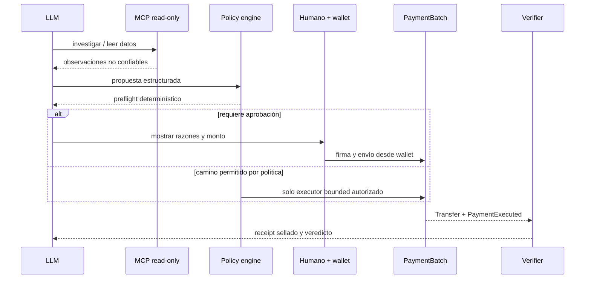

# VÉRTICE — Inventario de herramientas y patrones

Este documento separa las herramientas que forman parte del backend de VÉRTICE de las
fuentes de patrones que se revisaron durante la preparación. Una referencia revisada no
significa que su código esté integrado ni que su resultado sea evidencia de una
transacción.

## Herramientas propias de VÉRTICE

### Contratos Foundry

| Componente | Responsabilidad | Estado |
|---|---|---|
| `PaymentBatch` | Token fijo, allowlist, caps, replay protection y pagos atómicos | Implementado y desplegado |
| `PaymentVerifier` | Evaluación determinística de claim contra eventos reales | Implementado y probado |
| `PaymentReceiptRegistry` | Registro idempotente de receipts y digests | Implementado y desplegado |
| `forge test` | Tests unitarios, fuzz, invariantes y reentrancy | Ejecutado en el repositorio |
| `script/Deploy.s.sol` | Despliegue parametrizado por variables de entorno | Implementado |

### MCP read-only

El servidor está en [`mcp_server.py`](../mcp_server.py). Todas las herramientas usan
validación de entrada y devuelven errores explícitos. Ninguna recibe una clave privada.

| Herramienta | Entrada principal | Resultado |
|---|---|---|
| `get_chain_status` | Ninguna | `chainId`, bloque y RPC configurado |
| `get_business_policy` | Ninguna | Política bounded sin secretos |
| `get_token_config` | Ninguna | ARGt, `PaymentBatch` y registry |
| `list_invoices` | `VERTICE_INVOICES_PATH` | Facturas JSON o `available: false` |
| `create_payment_proposal` | Array de facturas | Pagos `READY` y exclusiones con razones (incluye `POSSIBLE_TYPO` con sugerencia) |
| `read_payment_status` | Hash de transacción | Receipt real, `SUCCESS`, `REVERTED` o pendiente |
| `verify_payment` | Hash, recipient, amount, `runId`, `invoiceRef` | Veredicto y checks derivados de logs |

### Dependencias operativas

- Foundry: compilación, tests, scripts y lectura de receipts.
- OpenZeppelin Contracts: `IERC20`, `SafeERC20` y `Ownable`.
- Arbitrum JSON-RPC: lectura de chain status, receipts y logs.
- Python MCP SDK: transporte stdio del servidor MCP.
- No se usa `web3.py`: el MCP hace JSON-RPC explícito y mantiene el decoder mínimo.
- No se usa una base de datos ni memoria semántica en el camino P0.

## Patrones revisados de repositorios existentes

### VELO

Patrón reutilizable para VÉRTICE:

- sellar el resultado antes de narrarlo;
- separar `VERIFIED`, `NOT_VERIFIED` e `INSUFFICIENT_EVIDENCE`;
- validar identificadores en la frontera MCP;
- ofrecer verificación independiente del resultado;
- tratar la narración del LLM como texto lateral, nunca como decisión.

No se integra el servidor VELO completo. VÉRTICE usa su propia semántica de eventos ERC-20
y su propio contrato de receipts.

### MNEME

Patrones útiles para una fase posterior:

- cadena de custodia enlazada por hashes;
- vocabulario cerrado de eventos;
- exportación y verificación offline de bundles;
- bridge read-only para inspección.

No es dependencia del pago P0. Puede usarse más adelante para cierre de período y
proveniencia de facturas.

### RAVEN-MEMORY

Su auditoría de cadena y estados ternarios son referencias conceptuales. No se incorpora
memoria adaptativa, embeddings ni ranking al camino de pagos: agregarlos ahora ampliaría el
alcance sin mejorar la prueba on-chain.

### ZAYNOR

Su ADR sobre capability planes define una regla que VÉRTICE adopta:

```text
MCP de investigación read-only
        ↓
motor determinístico
        ↓
intención bounded
        ↓
wallet humana / executor autorizado
```

Las capacidades de lectura, memoria, auditoría y autoridad no se mezclan en un único MCP.
El LLM no es una autoridad de pagos.

### FORGE

Patrones útiles para el cierre técnico:

- canonicalización versionada;
- hash chains para artefactos;
- diferencia entre integridad y verdad;
- `ABSTAIN` cuando la procedencia externa no puede autenticarse;
- HMAC opcional para artefactos privados, nunca con claves en Git.

FORGE no es una dependencia P0. Se lo puede usar como auditoría externa del repositorio o
para revisar un artefacto sellado después de estabilizar el flujo on-chain.

### VIGÍA

Se toma como fuente de tests adversariales y revisión de límites:

- confused deputy;
- path traversal y validación de entradas;
- determinismo;
- coherencia entre resultado y sello;
- superficies MCP demasiado amplias.

No se incorpora su motor forense al backend de VÉRTICE.

## Herramientas deliberadamente ausentes

- No existe herramienta MCP para firmar o enviar transacciones.
- No existe herramienta MCP para entregar la clave privada al agente.
- No existe herramienta MCP para modificar caps o allowlists.
- No existe OCR genérico, bridge, swap, Morpho, Curve activo o WhatsApp en P0.
- No se afirma que una factura externa sea verdadera solo porque Firecrawl la encontró.

## Flujo de autoridad



El diagrama describe la frontera conceptual. La implementación actual de este MCP solo
cubre los pasos de lectura, preparación y verificación; no ejecuta el camino de escritura.
